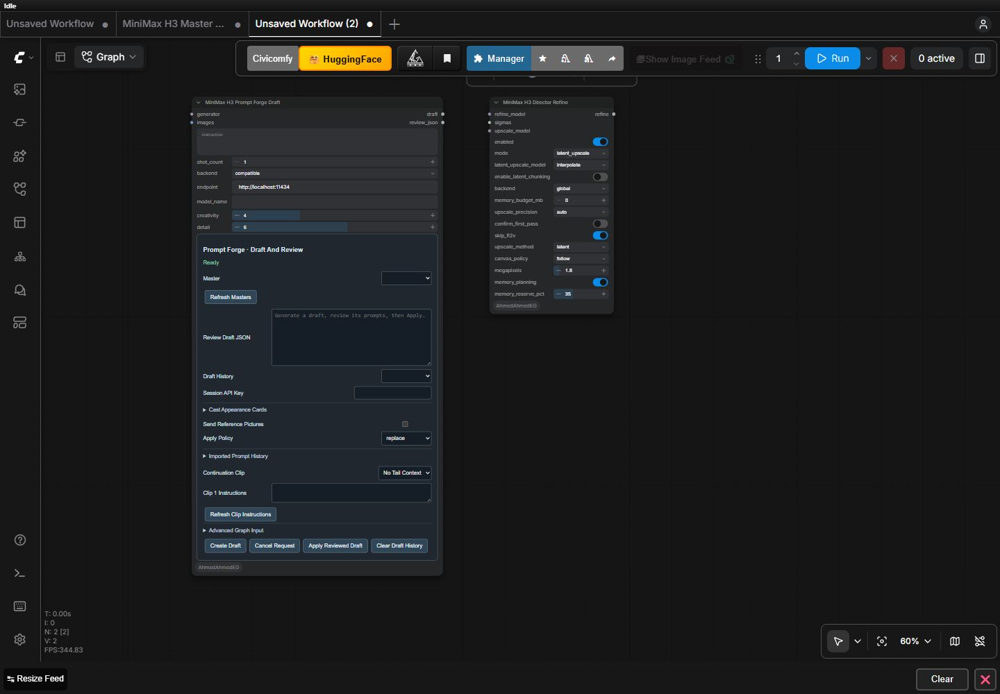

# Node integration and layout fixes — 1.7.2

16 October 2026. Resolves the confirmed findings in [the 1.7.1 node audit](node-placement-audit-1.7.1.md).

## Ownership and compatibility

- The shared timeline merge preserves explicitly supplied reference pools, shared selections and prompt placement, cast cards, imported history, RefMods, import bindings and audio-join settings. Imported project identity follows the authored timeline so restored takes remain accessible. An incoming different project cannot inherit the old project's clip approvals. Unspecified fields remain with the editable Master, and same-project execution controls retain their existing ownership.
- Review / Apply keeps its JSON string at output 0 and appends `MMX_TIMELINE` at output 1. Existing graph connections keep their indices. The typed output connects directly to a downstream Master; use an independent source timeline to avoid a cycle. The integrated Forge review path remains the normal interactive path.
- The Master metadata output is labelled `video_info`, retaining type `VHS_VIDEOINFO` and output index 2. Existing saved labels are migrated on configure. Actual frame/audio and native VIDEO export contracts are unchanged.
- The pack still has 27 public node types and one public Master registration. Pixel / RTX Upscale moves to Output. Standalone Review / Apply is marked Graph and grouped with Advanced graph tools. Cached project/shot export has a more explicit name; frame-batch Video Combine remains a distinct tool.

## Visible controls

- Forge exposes one transient Session API Key field for remote providers. The native legacy key remains readable for existing graph/API workflows but hidden in the ordinary panel. Local mode hides remote endpoint/auth controls; connected generators own the model selection.
- Raw shot descriptions and continuation IDs are hidden state. The graph-only timeline editor is inside Advanced Graph Input, with a clear distinction from the selected-Master interactive path. The review area is shorter.
- Hidden-state handling supports both Vue controls and legacy DOM textareas. The installed frontend's [visibility function reads `options.hidden`](https://github.com/Comfy-Org/ComfyUI_frontend/blob/v1.51.10/src/renderer/extensions/vueNodes/composables/useProcessedWidgets.ts); changing only widget type/legacy flags did not hide every control. Legacy DOM elements also receive explicit hidden styling and restore their prior display state when shown again.
- Pixel / RTX Upscale shows quality, denoise and deblur only for RTX providers. Its name no longer implies H3 diffusion refinement.
- Reference roles use a compact three-column group and explain that roles guide writing, while clip type and selected assets determine actual model inputs.

## Validation

221 backend tests and all six JavaScript suites passed. Focused tests cover metadata preservation, independent copies, project approval isolation, typed reviewed output, unique menu ownership, old output-label migration, idempotent typed-output migration, Vue option visibility and legacy textarea hiding.

On the deployed 1.7.2 process, an isolated Project Import → Master graph started from an empty local timeline and two restored synthetic native AV takes. Cards, historical prompt and shared selection reached the Master's `project_state`, project identity was preserved, both takes remained approved, ten frames were returned and generated=0. This job used real H3 VAEs and no diffusion model. Job: `e2a6dc3a-f8c8-4999-ba9b-dc9bc024ead3`; local evidence `.validation/typed-import172-history.json`. This does not constitute new diffusion quality/performance validation.

The running schema confirms 27 distinct node types, the appended typed Review / Apply output, `video_info`, and the new categories. Server updates and restarts were performed only after checking that no user jobs were running or pending.

## Final live presentation checks

The production extension was checked on a fresh ComfyUI page after discarding only the disposable audit workflow; an unsaved test graph had prevented earlier reload attempts from replacing the active module. No diagnostic overlay was active in the final check.

- Bicubic → RTX VSR showed quality/denoise/deblur; switching back to Bicubic removed them.
- Local → Compatible showed the endpoint and one transient Session API Key; switching back to Local removed both. Native key, raw timeline and raw shot-description controls were absent.
- Refine → Latent Upscale removed sampling controls and exposed sizing. Follow replaced manual width/height with megapixels. At unchanged zoom, the fresh Refine node shrank from about 432 to 374 screen pixels when sampling fields were hidden, rather than retaining its old empty height.
- The live Reference Pack role group contained eight checkboxes in three equal columns and the writing-versus-model-input explanation.
- Widget visibility accounts for the installed frontend's reactive metadata snapshot through a guarded legacy adapter; it does not import private store modules. Widget objects, serialized order and existing output indices remain stable. Saved hidden flags and callback-only updates have regression coverage.

This verifies the affected live layouts and mode transitions, not a blanket visual certificate for all 27 nodes. Existing unverified GPU diffusion-quality/performance comparisons remain outside this UI/integration change. Test-only graphs/tabs were closed and the authenticated local Node proxy was stopped after inspection.
